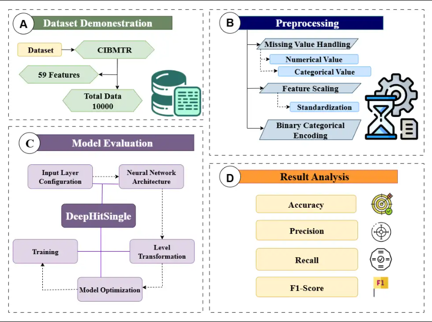
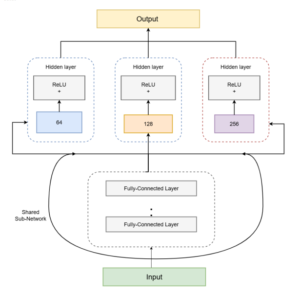

# Improving Event-Free Survival Prediction in Hematopoietic Cell Transplantation: A Data-Driven Approach Using DeepHitSingle

**Author:** Imran Munshi  
**Student ID:** 222-15-6376  
**Course:** CSE412 — Artificial Intelligence Lab (Grade Point: 4.00)  

---

## Abstract
Hematopoietic Cell Transplantation (HCT) is a vital treatment for high-risk hematologic malignancies such as leukemia and lymphoma[cite: 4]. However, post-HCT event-free survival (EFS) is highly variable. This project utilizes the "Equity in post-HCT Survival Predictions" dataset from the Center for International Blood and Marrow Transplant Research (CIBMTR) to build a robust preprocessing and deep learning framework using **DeepHitSingle**[cite: 4, 6]. The ultimate goal is to enhance predictive accuracy, address healthcare disparities, and assist clinicians in personalizing post-transplant strategies.

---

## Architecture & Workflow

The framework follows a structured pipeline as illustrated below:

### Workflow Pipeline

### Model Architecture (DeepHitSingle)

---

## Methodology & Pipeline

1. **Data Preprocessing:**
   * **Missing Value Imputation:** Mean imputation applied to continuous/numerical features; mode imputation applied to categorical variables.
   * **Feature Scaling:** Standardization ($\mu = 0, \sigma = 1$) applied to equalize feature distributions.
   * **Binary Categorical Encoding:** Compact representation used for binary clinical variables.
2. **Model Architecture:** 
   * Built on a multi-layer perceptron (MLP) backbone featuring hidden layers (256, 128, and 64 units) with ReLU activations and dropout regularization (0.3). Time-to-event outcomes are discretized into 120 intervals to handle right-censored data[cite: 6].
3. **Optimization:** 
   * Trained using a composite loss function combining log-likelihood and ranking terms, optimized via the Adam optimizer[cite: 6].

---

## Key Results & Ablation Studies

* **Performance Comparison:** The proposed DeepHit model achieved superior concordance in survival time predictions (**C-Index = 0.6910**) and sensitivity (**0.7562**) compared to baseline models like CoxPH and DeepSurv.
* **Hyperparameter Tuning:** Systematic evaluation of learning rates, batch sizes (optimal size: 128), and duration intervals demonstrated notable performance enhancements.

---

## Repository Contents
* Jupyter Notebook / Python Scripts containing the complete model pipeline.
* Visual architecture diagrams and confusion matrix evaluations.
